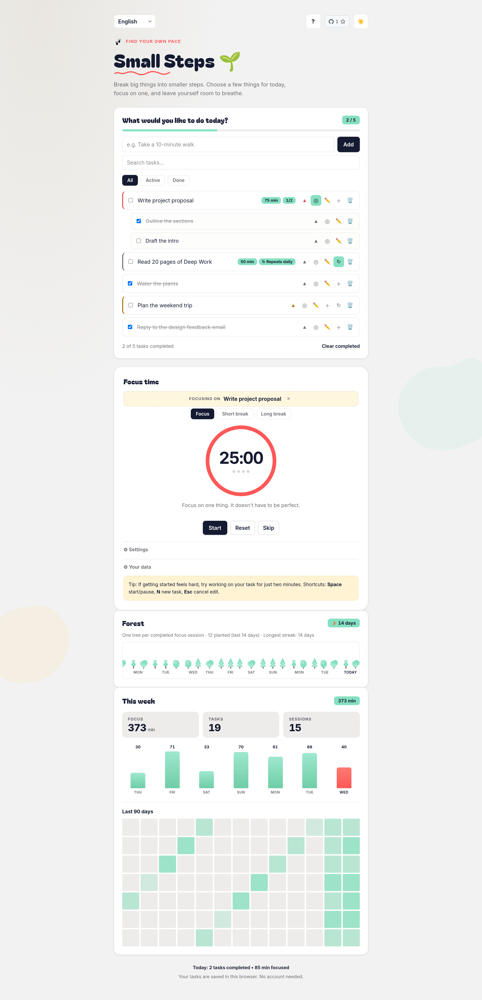
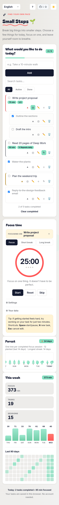

<p align="center"></p>

# Small Steps

<div align="center">

**A calm, offline-first focus workspace: task list + Pomodoro timer + progress history.**
Zero dependencies · 12 languages · Installable PWA · Your data never leaves your browser

<br/>

[](../../releases)
[](../../releases)
[](../../actions)
[](#-pwa-installation)
[](#-languages)
[](./LICENSE)
[](#-project-structure)

<br/>

[](https://firatnexus.github.io/small-steps/)

<br/>

<sub>[Türkçe sürüm](./README.tr.md)</sub>

</div>

---

## 📸 Screenshots

<div align="center">

| Desktop | Mobile |
|:---:|:---:|
|  |  |

</div>

---

## ✨ Features

### 📝 Tasks

- **Subtasks** — break a big task into smaller steps with ＋; the parent row shows a progress badge (e.g. 2/5)
- **Recurring tasks** — repeat daily / weekdays / weekly with ↻; completing one spawns the next occurrence automatically, early completion jumps past the scheduled day
- **Task-linked focus** — pick a task (◎) and every completed Pomodoro credits its minutes to that task
- **Priorities** — none / low / medium / high, with a colored accent
- **Search** — instant, diacritic-friendly (type "ikinci", find "İkinci")
- **Edit inline** (double-click), undo deletes, filters, progress bar
- Completed tasks keep counting toward your history even after you delete or clear them

### ⏱️ Pomodoro

- Focus / short break / long break cycle with configurable durations
- **Accurate crediting:** minutes are recorded against the day and duration the session *started* with — changing settings mid-session or crossing midnight won't corrupt your stats
- Auto-start breaks, sound chime, desktop notifications

### 📊 Progress

- Weekly focus chart, session / task / focus totals
- **90-day GitHub-style heatmap** of daily focus minutes
- Per-task focus totals

### 🌲 Forest & streak

- **A forest that grows with you** — every completed focus session plants a tree; trees are drawn procedurally (deterministic per day, zero assets) over the last 14 days
- **Daily streak** — consecutive active days (a task completed or a focus session), shown as a 🔥 badge next to the forest, with your longest streak on record
- Streaks survive the 90-day history window, and both the forest counters and your streak travel inside JSON backups

### 💾 Data

- **JSON export / import** — full backup of tasks, settings, history, theme and language
- **Todoist import (CSV)** — load your Todoist CSV export: tasks, priorities, dates and one-level hierarchy transfer over
- **CSV export** — open your tasks in spreadsheet apps (UTF-8 BOM + RFC 4180 compliant)
- Everything stays in `localStorage` — no account, no server, no tracking

### 🎨 Interface

- 4 themes: light, dark, sepia, high contrast
- Full RTL support (Arabic) and 12 languages
- Keyboard shortcuts (`?` shows the cheat sheet), screen-reader friendly
- **GitHub star badge** in the top bar — the repo's live star count, styled exactly like GitHub's own badge; tapping it opens the repository

---

## 🚀 Usage

### 🌐 Try Online

Open **[firatnexus.github.io/small-steps](https://firatnexus.github.io/small-steps/)** — no install, no signup.

### 💻 Local

```bash
git clone https://github.com/firatnexus/small-steps.git
cd small-steps
# macOS
open index.html
# Linux
xdg-open index.html
# Windows
start index.html
```

Or serve it (needed for the service worker / PWA install):

```bash
npx serve .
```

### 📱 PWA Installation

- **Android / Chrome / Edge:** install banner, or ⋮ menu → *Install app*
- **iOS Safari:** Share → *Add to Home Screen*
- Once installed, it works fully offline

### 📱 Android (APK)

The same app is packaged as a native Android app (Capacitor wrapper — no browser needed):

- **Download:** grab `small-steps-x.y.z.apk` from [Releases](../../releases) and install it ("install unknown apps" permission is required once)
- Same features, same data location, works fully offline
- The web PWA and the APK are separate installs — data does not sync between them
- On mobile the keyboard-shortcut `?` button is hidden (shortcuts need a keyboard); the GitHub star badge sits in its place and opens the repository in your browser
- **Build from source:** `npm ci && node scripts/build-app.mjs && npx cap sync android && cd android && ./gradlew assembleRelease` (CI signs releases with repo secrets)

### ⌨️ Keyboard Shortcuts

| Key | Action |
|---|---|
| `Space` | Start / pause timer |
| `N` | Focus the new-task field |
| `?` | Shortcut cheat sheet |
| `Esc` | Close dialogs / cancel edit |
| double-click | Edit a task |

---

## 🌍 Languages

English, Türkçe, Español, Français, Deutsch, Português, Italiano, हिन्दी, العربية, 中文, 日本語, Русский — with a key-parity test suite (`test.html`) and a CI check (`tools/check-translations.js`).

---

## 🏗️ Architecture

```
index.html        — structure
style.css         — themes + layout (4 themes, RTL, responsive)
app.js            — state, tasks, timer, stats, backup (IIFE, no framework)
translations.js   — i18n engine + 12 dictionaries
sw.js             — service worker (cache-first assets, network-first HTML)
manifest.json     — PWA manifest
capacitor.config.json + android/ — the Capacitor Android wrapper (APK)
scripts/build-app.mjs — copies the web app into www/ for the APK build
test.html         — browser test suite (i18n integrity)
tools/            — CI scripts
```

- **Zero dependencies** — vanilla HTML/CSS/JS, no build step
- **State** lives in `localStorage` under `small-steps-v2` (tasks, settings, stats) and `small-steps-history` (daily focus/done log, 90-day retention)
- **Timer** uses wall-clock (`endAt`) so background throttling can't drift it

---

## 🛠️ Customization

### ⏱️ Default Durations

In `app.js`, `DEFAULT_SETTINGS`:

```js
const DEFAULT_SETTINGS = {
  focus: 25, short: 5, long: 15, longEvery: 4,
  autoStart: false, sound: true
};
```

### 🎨 Color Palette

CSS custom properties in `style.css` (`--green`, `--break`, `--bg`, …) per theme block. Change once, all themes stay in sync.

### 🌍 Add a Language

1. Copy the `en:` block in `translations.js`, translate values (keep `{placeholders}` intact)
2. Add the code to the dictionary and to the expected list in `test.html`
3. Open `test.html` — the key-parity test verifies you didn't miss a string

---

## 💾 Data Storage

| Key | Contents |
|---|---|
| `small-steps-v2` | tasks, settings, filter, active task, daily stats |
| `small-steps-history` | `{ "YYYY-MM-DD": { focus, done } }`, last 90 days |
| `small-steps-theme` | selected theme |
| `small-steps-language` | selected language |

Example task record:

```json
{
  "id": "mvgjg40d-9o4em0",
  "text": "Write project proposal",
  "done": false,
  "createdAt": 1792491000000,
  "doneAt": null,
  "priority": 3,
  "focus": 50
}
```

Use **Settings → Your data → Export backup** for a full JSON backup you can move between browsers or devices. **Download tasks (CSV)** exports just the task list — use JSON for a full backup.

---

## 🧪 Testing

```bash
node tools/check-translations.js   # i18n key/placeholder parity (runs in CI)
npm ci && node tools/test-app.js   # app logic tests — real app.js on jsdom
```

Then open `test.html` in a browser for the full in-page suite (language switching, RTL, key parity, placeholder integrity).

---

## 🌐 Browser Support

Any modern browser with `localStorage` and flexbox/grid (Chrome, Firefox, Safari, Edge — desktop & mobile). Service worker features require HTTPS or localhost.

---

## 🤝 Contributing

Issues and PRs are welcome — see [CONTRIBUTING.md](./CONTRIBUTING.md). Keep it dependency-free: if a feature needs a framework, it probably doesn't belong here.

## 📜 License

[MIT](./LICENSE) — do whatever you like, attribution appreciated.
